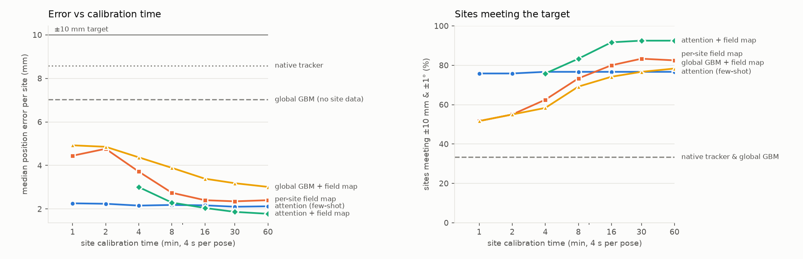
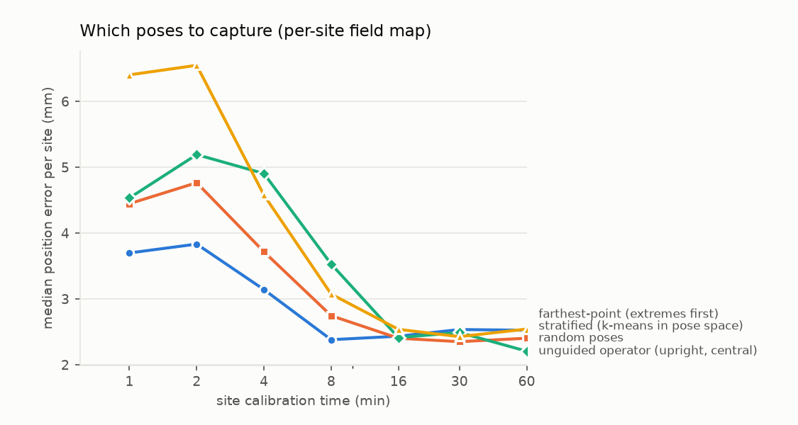

# em-tracking-correction

**Learned distortion correction for electromagnetic (EM) tracking that has to work in rooms it has never seen.**

A handheld X-ray emitter is located relative to the image cassette by an AC electromagnetic tracker. Metal in the room
(table frames, instrument trays, rails, tools) bends the field, and the tracker's pose solver turns that into
centimetre-level position errors and degree-level angle errors. Correcting it in the lab is easy. Correcting it at a
site full of metal configurations nobody trained on, to **±10 mm and ±1°**, after a short on-site calibration, is
the actual problem.

This repo builds that problem end to end on a physics simulator and measures what works:

- **Physics + native tracker.** Dipole field generator, 3-axis receivers, metal as induced dipoles (eddy-current
  spheres and plates, ferromagnetic rods), and a batched Levenberg–Marquardt pose solver that reproduces a real
  tracker's biased solutions near metal.
- **Wide multi-sensor data.** 5 sensors (two receivers on the emitter, a reference receiver on the cassette, and an
  accelerometer on each), 4 frames of history: **272 columns per row**, about 245k training rows from 240 rooms.
- **Generalisation-first evaluation.** Splits by environment and by region of space. 60 unseen clinic rooms, plus 5
  stress families never seen in training: metal right next to the emitter, a large plate under the table, clutter,
  stronger metal, and a clean room.
- **Models.** Global LightGBM / XGBoost / MLP (no site data); the classic per-site polynomial field map; and an
  **encoder-decoder attention model** that adapts to a new room from a handful of calibration poses, plus its
  combination with a field map.
- **The site-collection protocol.** Error against calibration minutes, and *which* poses to capture.
- **Production standards.** Data and run lineage, a tracking-validity flag, distribution-shift and coverage gates,
  ONNX packaging with a units- and invariant-checking validator, Docker runtime, and CI (ruff, mypy, pytest).
- **Low-dose fluoroscopy denoising.** Noise2Noise vs the 3×3 Gaussian + frame-averaging baseline on real
  radiographs, screened for hallucinated or erased structure.

Everything runs on a laptop (Apple M4): data generation takes about 2 minutes, the attention model trains in about
9 minutes on the Apple GPU (MPS), and the full evaluation takes about 15 minutes.

> All EM results come from simulation. They show the method, not a device's accuracy. See *Limitations*.

---

## Headline



On 60 clinic rooms never seen in training, the native tracker meets ±10 mm / ±1° in **33 %** of rooms. A global
model with no site data doesn't change that (**33 %**). With a site calibration:

- **1 minute** (15 poses): the attention model reaches **76 %** (median 2.3 mm / 0.53°).
- **16 minutes** (240 poses): attention + field map reaches **92 %** (2.0 mm / 0.34°).
- **60 minutes** (900 poses): no further gain (**92 %**, 1.8 mm / 0.33°). The 60-minute budget is more than this
  method needs.

Median position / angle error per room, then the share of rooms meeting the target (random capture protocol):

<!-- gen:budget -->
| method | 0 poses (0 min) | 15 poses (1 min) | 60 poses (4 min) | 240 poses (16 min) | 900 poses (60 min) |
|---|---|---|---|---|---|
| native tracker | 8.6 mm / 2.02° · **33 %** | – | – | – | – |
| global LightGBM (no site data) | 7.0 mm / 1.86° · **33 %** | – | – | – | – |
| encoder-decoder attention | 4.3 mm / 0.93° · **58 %** | 2.3 mm / 0.53° · **76 %** | 2.2 mm / 0.46° · **77 %** | 2.2 mm / 0.43° · **77 %** | 2.1 mm / 0.44° · **77 %** |
| per-site polynomial field map | – | 4.4 mm / 0.91° · **52 %** | 3.7 mm / 0.79° · **62 %** | 2.4 mm / 0.48° · **80 %** | 2.4 mm / 0.43° · **82 %** |
| global LightGBM + field map | – | 4.9 mm / 0.90° · **52 %** | 4.4 mm / 0.83° · **58 %** | 3.4 mm / 0.57° · **74 %** | 3.0 mm / 0.53° · **78 %** |
| attention + field map | – | – | 3.0 mm / 0.50° · **76 %** | 2.0 mm / 0.34° · **92 %** | 1.8 mm / 0.33° · **92 %** |
<!-- /gen:budget -->

### Stress test: environments from families never seen in training

Share of rooms meeting the target (median position error). "Valid frames" is the share the tracker doesn't reject
as an invalid fit (below).

<!-- gen:stress -->
| family (unseen in training) | valid frames | native tracker | global LightGBM (no site data) | encoder-decoder attention @ 1 min | per-site polynomial field map @ 16 min | attention + field map @ 16 min |
|---|---|---|---|---|---|---|
| clinic (in-family, unseen sites) | 96 % | 33 % (8.6 mm) | 33 % (7.0 mm) | 76 % (2.3 mm) | 80 % (2.4 mm) | 92 % (2.0 mm) |
| near emitter | 79 % | 20 % (9.6 mm) | 25 % (7.3 mm) | 55 % (4.9 mm) | 15 % (7.8 mm) | 78 % (3.9 mm) |
| under table | 98 % | 5 % (15.7 mm) | 0 % (15.8 mm) | 10 % (13.6 mm) | 98 % (1.0 mm) | 95 % (1.9 mm) |
| clutter | 95 % | 15 % (8.1 mm) | 20 % (8.6 mm) | 60 % (3.6 mm) | 75 % (3.2 mm) | 95 % (2.7 mm) |
| strong | 94 % | 30 % (18.9 mm) | 30 % (13.6 mm) | 55 % (3.7 mm) | 68 % (3.6 mm) | 95 % (2.4 mm) |
| clean | 100 % | 100 % (0.5 mm) | 100 % (0.7 mm) | 100 % (0.7 mm) | 100 % (0.6 mm) | 100 % (0.7 mm) |
<!-- /gen:stress -->

What this shows:

1. **No single method wins everywhere, and the failures are informative.** The attention model alone fails the
   under-table family (10 %): a large plate beneath the cassette is outside anything it learned. The plain per-site
   field map handles exactly that case (98 %), because it assumes nothing about the room. Near-emitter metal is the
   opposite: the field varies too sharply for a quadratic map (15 %), and the learned model does better (55–78 %).
2. **Combining them is the robust choice.** Attention + field map reaches 78–95 % on every family at 16 minutes.
3. **The shift detector predicts the case that breaks the learned model.** Under-table rooms trip the environment
   alarm on 73 % of frames; every other family stays at 4–10 % (below). So the system can tell when to trust the
   field map over the network.

### Which poses to capture



<!-- gen:protocols -->
| capture protocol | method | 1 min | 4 min | 8 min | 16 min | 60 min |
|---|---|---|---|---|---|---|
| stratified (k-means in pose space) | per-site polynomial field map | 3.70 mm | 3.14 mm | 2.38 mm | 2.43 mm | 2.52 mm |
| stratified (k-means in pose space) | attention + field map | – | 2.83 mm | 2.06 mm | 1.88 mm | 1.80 mm |
| random poses | per-site polynomial field map | 4.45 mm | 3.72 mm | 2.75 mm | 2.40 mm | 2.40 mm |
| random poses | attention + field map | – | 3.01 mm | 2.29 mm | 2.05 mm | 1.78 mm |
| unguided operator (upright, central) | per-site polynomial field map | 4.53 mm | 4.91 mm | 3.53 mm | 2.41 mm | 2.21 mm |
| unguided operator (upright, central) | attention + field map | – | 4.01 mm | 2.94 mm | 2.30 mm | 1.82 mm |
| farthest-point (extremes first) | per-site polynomial field map | 6.40 mm | 4.58 mm | 3.07 mm | 2.54 mm | 2.54 mm |
| farthest-point (extremes first) | attention + field map | – | 3.23 mm | 2.32 mm | 2.16 mm | 1.81 mm |
<!-- /gen:protocols -->

- **Guidance matters more than cleverness.** An unguided operator, who mostly holds the beam upright over the middle
  of the cassette, gets 68 % of rooms to target at 4 minutes and 84 % at 16 minutes (attention + field map). The same
  method with planned poses gets 76–79 % and 91–92 %. The operator's version needs about 30 minutes to catch up.
- **"Span the space" has to mean representative, not extreme.** Farthest-point sampling, the textbook coverage
  heuristic, spends its first poses on the corners of the workspace, and a field map fitted to corners extrapolates
  badly in the middle (6.4 mm at 1 minute vs 4.5 mm random). Stratified capture (k-means centres in position ×
  orientation space) gives the lowest error at every budget up to 16 minutes. In pass rate it's within noise of
  random on 60 rooms.
- **For this method the 60-minute budget is generous.** Every protocol converges by about 30 minutes, and planned
  capture reaches roughly the 60-minute quality in 16. The protocol to ship is: stratified target poses shown to the
  operator, about 240 of them.

### Evaluation design: how much does the split flatter the model?

Same LightGBM, three ways of holding out data (`scripts/split_study.py`):

<!-- gen:splits -->
| evaluation | median pos error | median angle error | sites meeting target |
|---|---|---|---|
| random row split (leaky) | 3.52 mm | 0.74° | 70 % |
| held-out environments | 4.59 mm | 1.20° | 44 % |
| held-out environments + outer shell (extrapolation) | 27.42 mm | 4.24° | 0 % |
| native tracker, held-out environments | 5.67 mm | 1.56° | 40 % |
| native tracker, outer shell | 5.82 mm | 1.52° | 35 % |
<!-- /gen:splits -->

- A random row split says **70 %** of rooms meet target; held-out rooms say **44 %**. Rows from the same room share
  its metal layout, so a random split leaks the exact thing the model must generalise over.
- **Spatial extrapolation is where learned corrections are dangerous.** Trained on the central volume and tested on
  the outer shell, the correction makes things **five times worse than doing nothing** (27.4 mm vs 5.8 mm). The
  dipole field changes fastest at the edges, and a tree model can't extrapolate.

### Distribution shift: knowing when not to correct

`emtrack/shift.py` has two monitors, each with a threshold set from in-distribution data before looking at the
shifted data:

- an **environment monitor**: Mahalanobis distance (Ledoit–Wolf) on the reference-receiver deviation, fit residuals,
  rigid-body consistency and IMU tilt disagreement;
- a **coverage gate**: distance to the nearest training poses in position × orientation space.

<!-- gen:shift -->
| spatial gate (outer shell, model trained on the central volume) | median pos error |
|---|---|
| native tracker | 5.8 mm |
| learned correction, ungated | 27.4 mm |
| learned correction, gated (fall back to native when flagged) | 10.6 mm |

Frames flagged: 61 % in the outer shell (Mahalanobis alone: 3 %), 1.6 % inside the trained volume.

| split | environment-shift alarm rate (threshold: 99th pct of validation sites) |
|---|---|
| test clinic | 5.0 % |
| near emitter | 3.9 % |
| under table | 73.3 % |
| clutter | 6.0 % |
| strong | 10.2 % |
| clean | 0.0 % |

A site's alarm rate predicts that the global model will miss the target there with AUROC 0.75 (105 of 150 sites miss).
<!-- /gen:shift -->

The environment monitor alone catches only 3 % of the out-of-volume frames: they look normal in every signal and
are simply somewhere the model never saw. The coverage gate catches 61 % and cuts the damage from 27 mm to 11 mm,
which is **still worse than the native tracker**. Gating limits harm but doesn't create competence. A learned
correction should only run inside the volume its calibration covered, and the coverage gate is how a device enforces
that.

### Tracking validity

Near strong metal the native solver occasionally diverges, reporting a pose kilometres away (0.65 % of training
frames had errors over 300 mm). `emtrack/data.py:valid_mask` rejects frames from **observable signals only**:
receiver fit residual, the native position staying in the plausible volume, and the two receivers agreeing on their
rigid separation. It catches 99.9 % of the catastrophic frames while rejecting 7 % overall. Correction models train
and run only on valid frames, and each family's valid-frame rate is reported as an availability metric (79 % with
metal next to the emitter).

### Sensor ablations (global model)

<!-- gen:ablations -->
| global model, features | clinic pos | clinic angle | strong-metal pos |
|---|---|---|---|
| all 272 features | 7.03 mm | 1.86° | 13.61 mm |
| without the reference receiver | 9.34 mm | 1.81° | 15.62 mm |
| without the IMUs | 6.69 mm | 1.76° | 17.75 mm |
| current frame only (no lags) | 7.22 mm | 1.67° | 12.60 mm |
<!-- /gen:ablations -->

The reference receiver is what gives the global model any grip on an unseen room (7.0 → 9.3 mm without it). The
accelerometers and frame history make no measurable difference *for the global model*, which is too weak overall
for them to show. Site calibration, not more sensors, is what moves the numbers.

---

## Low-dose fluoroscopy denoising

Could a learned denoiser replace the current **3×3 Gaussian + frame averaging**, at lower dose, without
inventing or erasing anatomy? Data: [FracAtlas](https://doi.org/10.1038/s41597-023-02432-4) radiographs (hand, leg,
hip and shoulder; CC BY 4.0), held-out test images with fracture boxes. Each radiograph is treated as an attenuation
map; fluoroscopy frames of a **static scene** are simulated with Poisson photon noise plus electronic noise at
100–800 photons/pixel. Noise2Noise trains only on pairs of independent noisy frames, which is all real fluoroscopy
provides; a supervised model on clean targets is the upper bound.

<!-- gen:denoise -->
_not run yet_
<!-- /gen:denoise -->

Flat-field phantom (the ideal output is perfectly flat; any structure is invented):

<!-- gen:flat -->
_not run yet_
<!-- /gen:flat -->

DENOISE_NARRATIVE

---

## ML engineering standards

- **Data lineage.** `data/<version>/manifest.json` records the generator config, seed, git SHA and the SHA-256 of
  every file. `emtrack/lineage.verify_manifest` refuses to train on data that changed after it was recorded.
- **Experiment tracking.** Every run writes `runs/<id>/run.json` (config, config hash, dataset hash, git SHA,
  metrics, artifact hashes) and appends to `runs/registry.jsonl`, so any model traces back to the exact data and code.
  The registry keeps superseded runs too (for example the global model before the validity flag existed).
- **ONNX package contract** (`emtrack/package.py`). Normalisation lives inside the graph; `manifest.json` lists every
  input column with its **unit** and training range, the output units and how to apply them, plus the dataset hash.
  The validator fails the build unless:
  - the ONNX file matches the manifest hash and schema
  - ONNX and PyTorch agree (max diff 3e-5 mm)
  - the output doesn't depend on the order of the calibration set (a set model must be permutation-invariant;
    max diff 2e-5)
  - the **units guard** rejects the same inputs sent in metres instead of millimetres
  - a metal-free room gets near-zero correction (0.35 mm / 0.08°)
  - outputs stay within physical bounds

  It caught a real bug: the legacy ONNX exporter froze the calibration-set size into the attention reshapes, so the
  exported model only worked with exactly 8 calibration poses.
- **Runtime.** `emtrack/package_runtime.py` needs only NumPy and ONNX Runtime and guards inputs against the manifest.
  The Docker image ships exactly that.
- **CI.** ruff, mypy and pytest (physics invariants, exact solver recovery, protocol behaviour, manifest
  tamper-detection, package validation), a tiny end-to-end data generation with a manifest round-trip, and a Docker
  build that loads the committed package.

## Run it

```bash
python -m venv .venv && .venv/bin/pip install -r requirements.txt
./scripts/fix_libomp_macos.sh        # macOS without Homebrew: xgboost/lightgbm reuse torch's libomp
make data          # ~2 min, 1.3 GB in data/v1 (simulated, regenerable from the config + seed)
make global attention evaluate studies report package check
.venv/bin/python fluoro/train.py n2n_single && .venv/bin/python fluoro/evaluate.py   # needs FracAtlas in data/fracatlas
```

## Layout

```
emtrack/
  physics.py      dipole field generator, receivers, induced-dipole metal (Born approximation)
  solver.py       batched Levenberg-Marquardt native pose solver (float64, finite-difference Jacobian)
  simulate.py     environment families, trajectories, the 5-sensor / 272-column feature table
  data.py         loading + the observable-only tracking-validity flag
  sitefit.py      per-site polynomial field map
  attention.py    encoder-decoder attention (set encoder over calibration poses, cross-attention decoder)
  protocols.py    capture protocols: random, stratified, farthest-point, unguided-operator
  shift.py        environment Mahalanobis monitor + pose-coverage gate
  lineage.py      dataset manifests, run records, registry
  package.py      ONNX export, manifest with units, validator;  package_runtime.py: deployable loader
fluoro/           fluoroscopy simulation, U-Net, Noise2Noise / supervised training, evaluation + hallucination screens
scripts/          make_data, train_global, train_attention, eval_sites, split_study, shift_study, package_model, make_report
package/          the validated ONNX model + manifest + validation report
```

## Limitations

- **Simulation, not hardware.** The field model is ideal dipoles with first-order (Born) metal response, real-valued
  (no eddy-current phase), static metal, and no sensor cross-talk or temperature drift. Real distortion is messier,
  and the absolute millimetre numbers would change. What should transfer is the *evaluation design*: environment and
  spatial splits, stress families, the budget curve, and gating. That's the part to rebuild on real data first.
- **The native solver starts near the true pose** (a tracking-style warm start). A cold-start solver near strong metal
  fails more often than the 7 % rejected here.
- **Calibration time** assumes 4 s per pose with a tracked reference (a jig or optical tracker). The budget curve is
  in poses, and minutes are that conversion.
- **Stress families are my guesses** at what clinics contain. The under-table result shows a family can break a
  learned model completely, so real sites need monitoring, not just this test.
- **One seed per model.** Differences of a few percentage points between methods are within site-to-site noise
  (n = 20–60 rooms per row).
- **Denoising** uses static scenes, simulated noise on radiographs that already contain noise and processing, and
  no detector blur or lag. Image metrics are not reader studies, and the hallucination screens are necessary,
  not sufficient.
